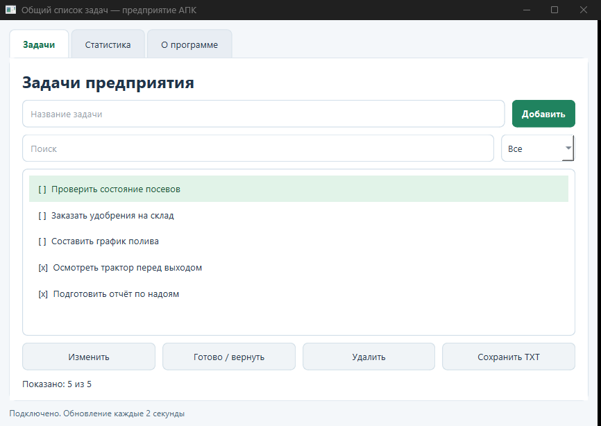
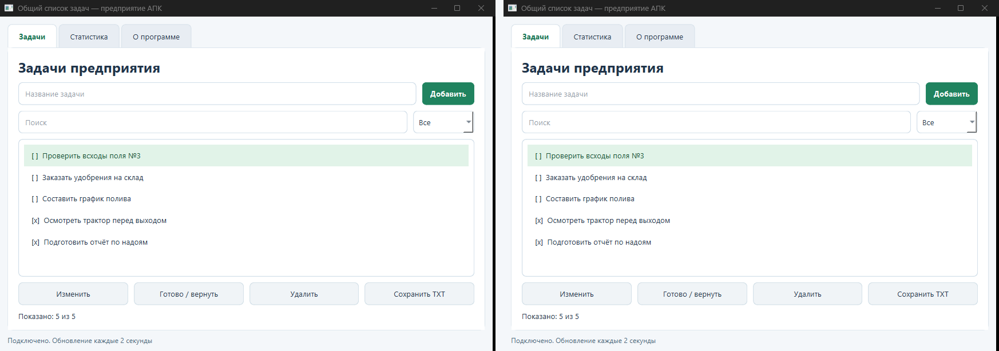

# Общий список дел

Приложение для общего списка задач на двух компьютерах. Сервер на FastAPI хранит задачи в SQLite, клиент на PySide6 показывает окно со списком. Изменения, сделанные на одном компьютере, появляются на втором после обновления.



## Что умеет

- добавлять, переименовывать и удалять задачи;
- отмечать задачу выполненной и возвращать в работу;
- искать по названию и фильтровать по состоянию;
- показывать статистику по списку;
- сохранять задачи в TXT;
- работать на двух компьютерах в одной локальной сети.

## Стек

- Python 3
- PySide6
- FastAPI + Uvicorn
- SQLite
- requests

## Запуск на одном компьютере

```bash
pip install -r requirements.txt
```

Затем запустить `START.bat`. Откроется сервер и два окна клиента.

## Запуск на двух компьютерах

На первом компьютере:

1. Запустить `SERVER_ONLY.bat`.
2. Узнать IPv4 командой `ipconfig`.

На втором компьютере:

1. Скопировать папку проекта.
2. Запустить `CLIENT_OTHER_PC.bat` и ввести адрес первого компьютера.

Сервер слушает порт 8000 на всех интерфейсах. Компьютеры должны быть в одной сети, порт 8000 должен быть разрешён в брандмауэре.



## Проверка

```bash
pip install -r requirements-dev.txt
python -m pytest tests -q
```

Тесты используют временную базу и проверяют добавление, переименование, смену состояния, удаление, ошибки ввода и общий список для двух клиентов.

## Структура

```
server.py              сервер FastAPI и SQLite
client.py              окно PySide6
tests/test_server.py   автотесты сервера
START.bat              сервер и два клиента на одном ПК
SERVER_ONLY.bat        только сервер
CLIENT_OTHER_PC.bat    клиент для второго ПК
report/                пояснительная записка (LaTeX) и PDF
README.txt             старые подробные инструкции
```

## Ограничения

- Нет авторизации и разделения прав.
- HTTP без шифрования, рассчитан на доверенную локальную сеть.
- Список обновляется опросом раз в две секунды, без push-уведомлений.

## Курсовой проект

Пояснительная записка находится в `report/main.pdf`, исходники — `report/main.tex` и `report/chapters/`.
